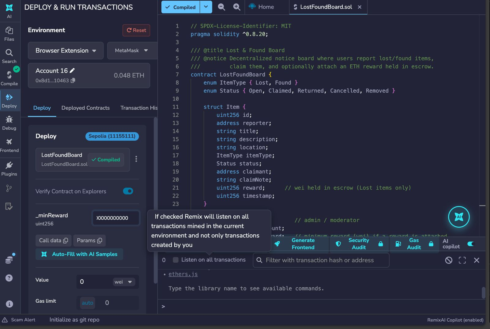
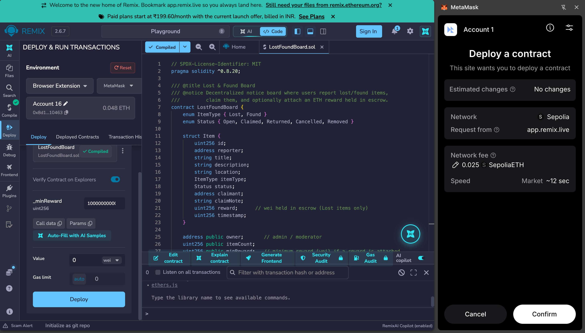
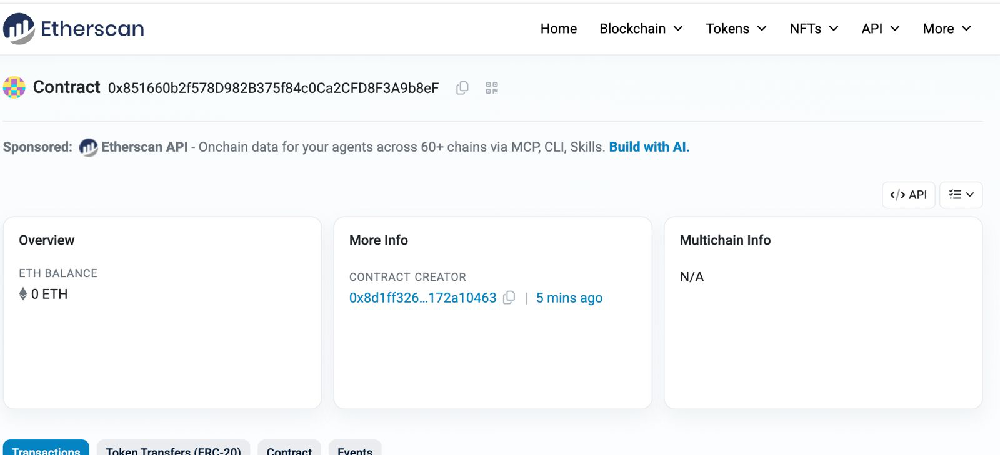
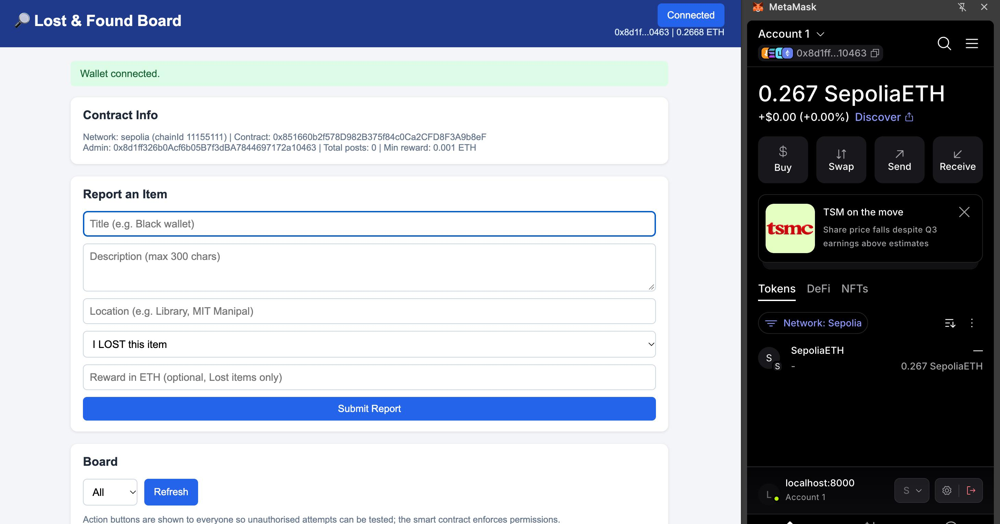
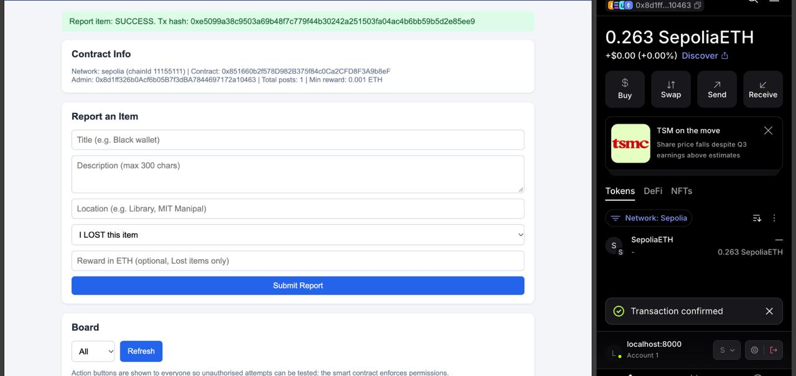
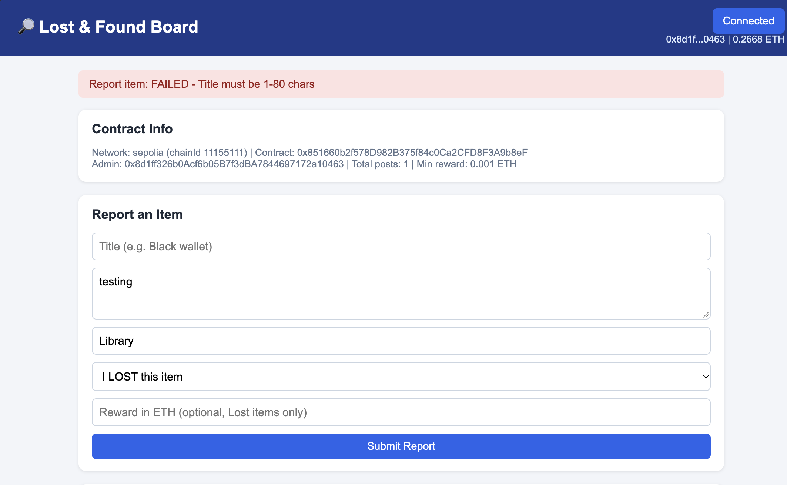
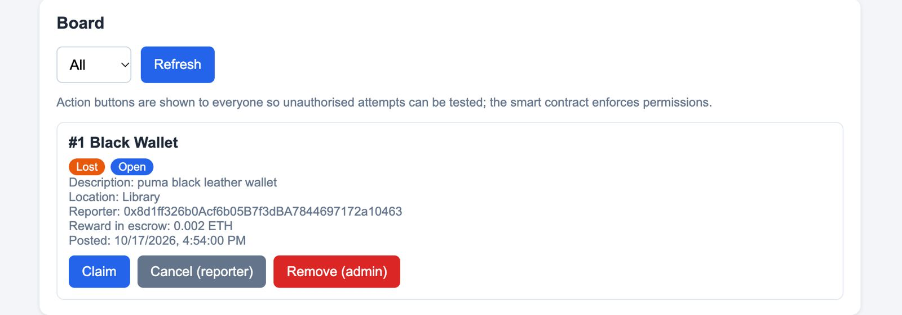

# Lost & Found Board – Ethereum DApp

**Course:** Blockchain Technology (CSE4444) – Assignment 2
**Student:** `Adithya M Adiga`  |  **Reg. No.:** `230905008`
**DApp Title:** Lost & Found Board – A Decentralized Item Recovery Platform

---

## 1. Problem Statement
Lost items on campuses and public places are usually reported on scattered notice boards or chat groups. These are easy to tamper with, give no proof of who claimed what, and offer no trustworthy way to reward the finder.

This DApp provides a tamper-proof **Lost & Found notice board** on Ethereum:

- Users post **Lost** or **Found** items (title, description, location).
- A Lost-item poster can lock an **ETH reward in escrow** inside the smart contract.
- Another user submits a **claim** with a note.
- The reporter can **confirm the return** (reward is automatically paid to the finder), **reject** the claim (item re-opens), or **cancel** the post (reward refunded).
- An **admin** (the contract deployer) can remove spam posts; the reward is refunded to the reporter.

## 2. Technology Stack
- **Smart contract:** Solidity ^0.8.20
- **Development/Deployment:** Remix IDE + MetaMask (Injected Provider)
- **Network:** Sepolia test network
- **Frontend:** HTML, CSS, JavaScript
- **Wallet / Web3 library:** MetaMask + Ethers.js v6

## 3. Project Structure
```
contracts/LostFoundBoard.sol   Smart contract
frontend/index.html            User interface
frontend/style.css             Styling
frontend/app.js                Ethers.js + MetaMask logic
frontend/config.js             Contract address + ABI
screenshots/                   Evidence images
README.md
```

## 4. Smart Contract Overview
| Element | Details |
|---|---|
| Constructor | `constructor(uint256 _minReward)` – sets the admin (`owner = msg.sender`) and the minimum reward |
| State variables | `owner`, `itemCount`, `minReward`, `mapping(uint256 => Item) items` |
| Functions | `reportItem`, `claimItem`, `confirmReturn`, `rejectClaim`, `cancelItem`, `removeItem`, `getItem` |
| Modifiers | `onlyOwner`, `onlyReporter`, `validId` |
| Validation | Title 1–80 chars, location 1–100 chars, description ≤ 300 chars, claim note 1–200 chars, reward only for Lost items and ≥ minimum, state checks, no self-claims |
| Events | `ItemReported`, `ItemClaimed`, `ClaimRejected`, `ItemReturned`, `ItemCancelled`, `ItemRemoved` |

## 5. Deployment Details
| Item | Value |
|---|---|
| Network | Sepolia Testnet (Chain ID 11155111) |
| Contract address | `0x851660b2f578D982B375f84c0Ca2CFD8F3A9b8eF` |
| Etherscan link | `https://sepolia.etherscan.io/address/0x851660b2f578D982B375f84c0Ca2CFD8F3A9b8eF` |
| Deployer / Admin | `0x8d1ff326b0Acf6b05B7f3dBA7844697172a10463` *(verify this is the account you deployed from)* |
| Deployment Tx hash | `0x8bebfd968d0ce7d68c7970f28b1f7155094cb6bc61ed9cd63bea7adbd91c1973` |
| Constructor argument | `1000000000000000` (0.001 ETH minimum reward) |
| Compiler | Solidity 0.8.34 (Remix) |

## 6. How to Run the Application

### 6.1 Compile and deploy the contract (Remix)
1. Open https://remix.ethereum.org and create `contracts/LostFoundBoard.sol`; paste the contract code.
2. Open the **Compile** tab → compiler 0.8.20 or newer → **Compile LostFoundBoard.sol**.
3. Open the **Deploy** tab → Environment: **Injected Provider – MetaMask** (MetaMask on **Sepolia**).
4. Enter the constructor argument `1000000000000000` and click **Deploy**; confirm in MetaMask.
5. Copy the deployed contract address.

### 6.2 Run the frontend
1. Paste the contract address into `frontend/config.js`:
   ```js
   const CONTRACT_ADDRESS = "0x851660b2f578D982B375f84c0Ca2CFD8F3A9b8eF";
   ```
2. Start a local web server (do not open the HTML file directly):
   ```bash
   cd frontend
   python3 -m http.server 8000
   ```
3. Open **http://localhost:8000** in Chrome with MetaMask installed.

## 7. Connecting MetaMask and Interacting with the Contract
1. Install the MetaMask browser extension and create or import a wallet (never share your recovery phrase).
2. Switch MetaMask to the **Sepolia** test network and fund the account with test ETH from a faucet.
3. Open the DApp and click **Connect MetaMask**, then approve the connection.
4. The page shows your address, balance, network, contract address, admin address and total posts.
5. Use **Report an Item** to post a Lost or Found item (optionally attaching an ETH reward for Lost items).
6. Use the buttons on each board item: **Claim**, **Confirm Return**, **Reject Claim**, **Cancel**, **Remove (admin)**. Approve each transaction in MetaMask.
7. Transaction hashes and error messages are displayed at the top of the page. All board data is read live from the blockchain.

> The board shows every action button to every user on purpose. This makes it possible to test unauthorised actions, which the smart contract rejects.

## 8. Test Cases
Fill in the **Observed** column with what you saw on the page.

| # | Type | Action | Expected Result | Observed |
|---|---|---|---|---|
| 1 | Valid | Report a Lost item (title, location, 0.002 ETH reward) | Tx succeeds; item appears as Open with reward in escrow | Transaction confirmed in MetaMask. Item appeared on the board with status Open and "Reward in escrow: 0.002 ETH". |
| 2 | Valid | Report a Found item, no reward | Tx succeeds; item appears as Open | Transaction confirmed. Item appeared as Found with status Open and 0 ETH reward. |
| 3 | Valid | Account B claims an open item with a note | Status becomes Claimed | Claim transaction confirmed. Status changed to Claimed and the claimant address and note were displayed. |
| 4 | Valid | Reporter confirms return | Status becomes Returned; reward sent to claimant | Transaction confirmed. Status changed to Returned and the 0.002 ETH reward was transferred to the claimant's wallet. |
| 5 | Valid | Reporter rejects a claim | Status returns to Open; claimant cleared | Transaction confirmed. Status returned to Open and the claimant and note were cleared. |
| 6 | Valid | Reporter cancels an open item with reward | Status becomes Cancelled; reward refunded | Transaction confirmed. Status changed to Cancelled and the 0.002 ETH reward was refunded to the reporter's wallet. |
| 7 | Invalid | Report with empty title | Revert: `Title must be 1-80 chars` | Rejected. Page displayed "Report item: FAILED - Title must be 1-80 chars". No item was created. |
| 8 | Invalid | Report with empty location | Revert: `Location must be 1-100 chars` | Rejected. Page displayed "Report item: FAILED - Location must be 1-100 chars". |
| 9 | Invalid | Report a Found item with a reward | Revert: `Reward allowed only for Lost items` | Rejected. Page displayed "Report item: FAILED - Reward allowed only for Lost items". |
| 10 | Invalid | Lost item with reward 0.0001 ETH (below minimum) | Revert: `Reward below minimum` | Rejected. Page displayed "Report item: FAILED - Reward below minimum". |
| 11 | Invalid | Claim with an empty note | Revert: `Note must be 1-200 chars` | Rejected. Page displayed "FAILED - Note must be 1-200 chars". |
| 12 | Invalid | Claim an item that is already Claimed | Revert: `Item is not open` | Rejected. Page displayed "FAILED - Item is not open". |
| 13 | Invalid | Access a non-existent item ID | Revert: `Item does not exist` | Rejected. Contract returned "Item does not exist" for an ID beyond the item count. |
| 14 | Unauthorised | Reporter claims their own item | Revert: `Reporter cannot claim own item` | Rejected. Page displayed "FAILED - Reporter cannot claim own item". |
| 15 | Unauthorised | Non-reporter clicks Confirm Return | Revert: `Only the reporter can do this` | Rejected. Page displayed "FAILED - Only the reporter can do this". |
| 16 | Unauthorised | Non-reporter clicks Cancel | Revert: `Only the reporter can do this` | Rejected. Page displayed "FAILED - Only the reporter can do this". |
| 17 | Unauthorised | Non-admin clicks Remove | Revert: `Only admin can do this` | Rejected. Page displayed "FAILED - Only admin can do this". |
| 18 | Valid | Admin removes an item | Status becomes Removed; reward refunded to reporter | Transaction confirmed from the admin account. Status changed to Removed and any escrowed reward was refunded to the reporter. |

## 9. Screenshots

### 9.1 Smart contract compilation


### 9.2 Smart contract deployment
Deployment in progress:



Contract deployed:



### 9.3 MetaMask wallet connection


### 9.4 Successful transaction


Transaction proof:


### 9.5 Failed transaction


### 9.6 Blockchain data displayed through the user interface



